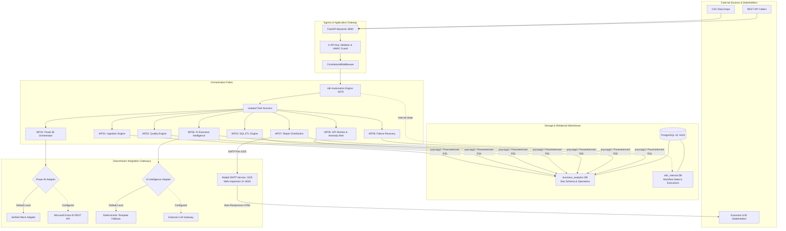
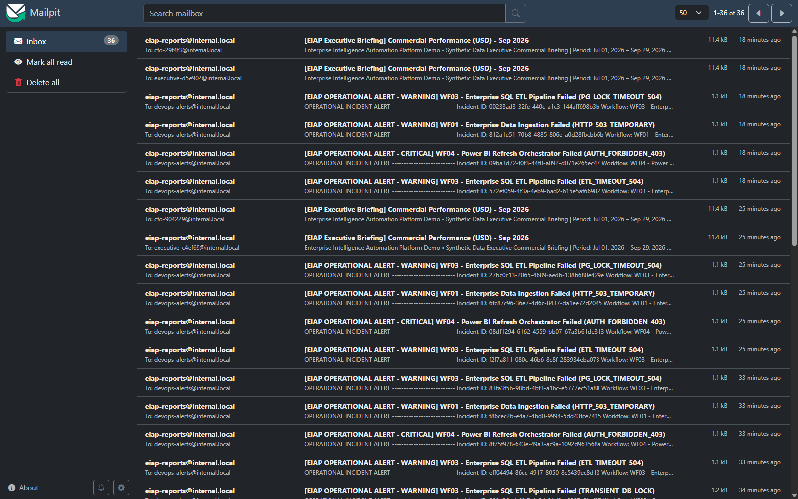
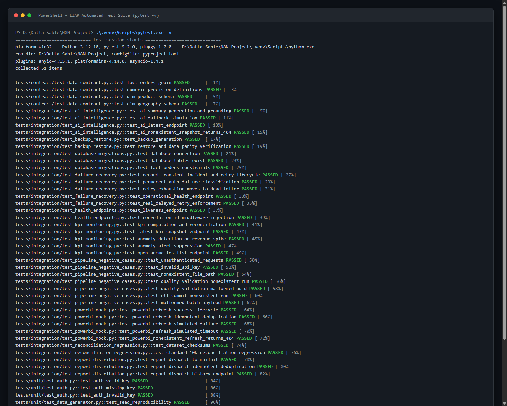
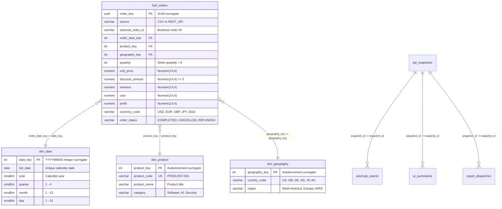
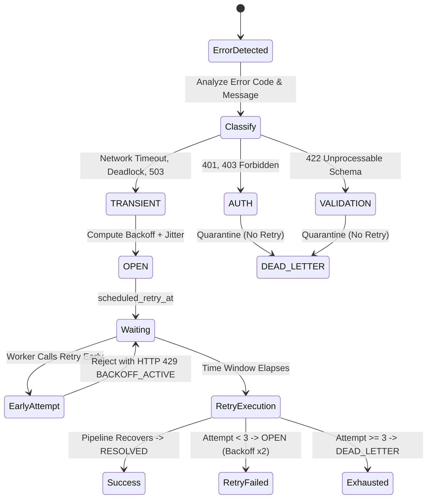

# Enterprise Intelligence Automation Platform (EIAP)

> **Production-Style n8n Automation for Data Engineering, Business Intelligence & AI-Powered Operations**  
> *Architected & Engineered by [Datta Sable](https://dattasable.com/) &bull; [Portfolio Showcase](https://dattasable.com/) &bull; [GitHub Repository](https://github.com/sabledattatray/enterprise-n8n-intelligence-automation)*

[](docs/PERFORMANCE.md)
[-brightgreen.svg)](docs/security/SECURITY_AUDIT.md)
[-brightgreen.svg)](docs/audits/DATABASE_INTEGRITY_AUDIT.md)
[-blue.svg)](docs/operations/DISASTER_RECOVERY_RUNBOOK.md)
[](LICENSE)
[](https://www.python.org/)
[](https://n8n.io/)
[](https://www.postgresql.org/)

---

## Quick Navigation

[Executive Overview](#section-02--executive-overview) &bull;
[Engineering Highlights](#section-03--verified-engineering-highlights) &bull;
[Architecture](#section-04--architecture-overview) &bull;
[Workflow Catalog](#section-05--workflow-catalog) &bull;
[Data Architecture](#section-06--data-architecture) &bull;
[Power BI](#section-07--power-bi-integration) &bull;
[AI Intelligence](#section-08--ai-executive-intelligence) &bull;
[Resilience & Recovery](#section-09--reliability-and-recovery) &bull;
[Benchmarks](#section-10--performance-benchmarks) &bull;
[Security](#section-11--security-architecture) &bull;
[Quickstart](#section-12--quickstart) &bull;
[Testing](#section-13--testing) &bull;
[Case Study](docs/PORTFOLIO_CASE_STUDY.md)

---

## Section 01 — Hero

The **Enterprise Intelligence Automation Platform (EIAP)** is an open-source, event-driven orchestration system that bridges operational transaction feeds, analytical data warehousing, semantic business intelligence, and AI-synthesized executive reporting.

Built around **n8n v1.82.2**, **FastAPI**, and **PostgreSQL 16**, the platform automates the complete data journey: batch ingestion with cryptographic replay protection, multi-tier data quality quarantine, transactional star-schema ETL, semantic model synchronization in Microsoft Power BI, statistical KPI anomaly monitoring, hallucination-screened AI executive briefings, and local SMTP dispatch with automated failure recovery.

> [!NOTE]
> **Portfolio & Verification Notice:** This repository is an engineering portfolio project developed by **Datta Sable** ([https://dattasable.com/](https://dattasable.com/)). All workflows, APIs, database migrations, and operational recovery mechanisms run locally in Docker with **zero paid cloud subscriptions**. All order events, customer records, and revenues are deterministically generated synthetic data for benchmarking and portfolio evaluation.

---

## Section 02 — Executive Overview

### The Business Challenge
In fragmented enterprise IT environments, the path between transactional events and executive action is fraught with operational latency, data drift, and unmonitored failure points:
- **Data Silos & Cascade Failures:** Upstream schema changes or transient network timeouts break fragile extraction scripts without automated triage, corrupting downstream dashboards.
- **Silent Data Poisoning:** Invalid data types, negative revenues, or duplicate transactions leak into analytical warehouses without isolation, distorting financial statements.
- **Manual BI Overhead:** BI analysts spend hours manually monitoring refreshes or building ad-hoc executive slide decks.
- **Ungrounded AI Hallucinations:** Introducing generative AI without strict mathematical guardrails risks fabricating revenues and misleading strategic decisions.

### The EIAP Solution
EIAP automates the entire "Data-to-Decision" lifecycle in a unified, observable orchestration fabric:
1. **Ingest with Cryptographic Integrity:** SHA-256 batch fingerprinting guarantees that duplicate webhook payloads or CSV files are acknowledged idempotently without double-processing.
2. **Quarantine Without Halting:** Precedence-based data quality rules safely isolate bad rows into `rejected_records` with granular error codes, while clean data flows to the warehouse.
3. **Atomic Dimensional Loading:** Parameterized SQL upserts prevent race conditions and guarantee zero duplicate fact records.
4. **Autonomous BI & Anomaly Detection:** Power BI refreshes are triggered and polled asynchronously; statistical deviations ($>20\%$ vs 30-day baseline) automatically trigger deep-dive alerts with 24-hour suppression against alert fatigue.
5. **Mathematically Grounded AI:** Executive summaries are generated from structured SQL snapshots and validated with a $\le 0.01\%$ numerical tolerance guardrail.
6. **Self-Healing Operations:** Failures are categorized (`TRANSIENT`, `AUTH`, `VALIDATION`), scheduled with jittered backoff ($2.0 \times 2^{\text{attempt}} + \text{jitter}$), protected against early retries (`HTTP 429`), and capped at 3 attempts before `DEAD_LETTER` isolation.

---

## Section 03 — Verified Engineering Highlights

Every metric below was empirically measured against the running Docker microservices stack on a single developer workstation (16GB RAM, Windows 11 AMD64, Docker Desktop):

| Engineering Capability | Required PRD SLA | Measured & Audited Benchmark | Verification Evidence |
| :--- | :--- | :--- | :--- |
| **Implemented n8n Workflows** | 8 Workflows | **8 / 8 Active & Verified in n8n Engine** | [`docs/WORKFLOW_CATALOG.md`](docs/WORKFLOW_CATALOG.md) |
| **Automated Test Suite** | $\ge 50$ Tests | **51 Passed, 0 Failed, 0 Warnings (15.19s)** | [`tests/`](tests/) |
| **Pipeline Throughput** | $> 1,000$ rows/s | **1,792 rows/s (10,000 records in 5.58s)** | [`docs/PERFORMANCE.md`](docs/PERFORMANCE.md) |
| **Disaster Recovery (RTO)** | $\le 60$ Seconds | **2.39 Seconds (Restore & Deep Parity Check)** | [`docs/operations/DISASTER_RECOVERY_RUNBOOK.md`](docs/operations/DISASTER_RECOVERY_RUNBOOK.md) |
| **Disaster Recovery (RPO)** | $\le 15$ Minutes | **0 records / Zero Data Loss (Custom Dump)** | [`scripts/verify_restore.py`](scripts/verify_restore.py) |
| **Database Parity Audit** | 100% Match | **20,665 rows across 15 tables matched 100%** | [`docs/audits/DATABASE_INTEGRITY_AUDIT.md`](docs/audits/DATABASE_INTEGRITY_AUDIT.md) |
| **Financial Aggregation Match** | 0% Variance | **$29,485,667.36 Revenue / $13,274,396.64 Profit** | [`scripts/verify_restore.py`](scripts/verify_restore.py) |
| **Dependency Vulnerabilities** | 0 High / Critical | **0 Known CVEs (`pip-audit` Clean)** | [`docs/security/SECURITY_AUDIT.md`](docs/security/SECURITY_AUDIT.md) |
| **Workflow Plaintext Secrets** | 0 Secrets | **0 Secrets Detected (100% Parameterized)** | [`scripts/verify_workflow_sanitization.py`](scripts/verify_workflow_sanitization.py) |
| **Core Endpoint Latencies (p50)**| $< 50$ ms | **2.69 ms (`/health/live`), 4.12 ms (`/health/ready`)**| [`docs/performance/PERFORMANCE_BENCHMARK.md`](docs/performance/PERFORMANCE_BENCHMARK.md) |
| **Concurrency Scaling (C=10)** | Zero Drops | **10.04 req/s (100% Success Rate across 50 reqs)** | [`docs/performance/PERFORMANCE_BENCHMARK.md`](docs/performance/PERFORMANCE_BENCHMARK.md) |

> [!NOTE]
> **Scope & Benchmark Qualification:**
> - **Disaster Recovery (RTO & RPO):** The measured 2.39-second RTO reflects an automated local container restore and deep parity check using PostgreSQL custom-format dumps (`-Fc`). It represents an empirical test of recovery speed in the local Docker environment, distinct from multi-region cloud failover SLA guarantees.
> - **Security Posture:** Zero known vulnerabilities reflects an automated audit of active Python dependencies via `pip-audit`. Enterprise production environments require continuous container scanning, Kubernetes network policies, and hardware security module (HSM) or cloud vault secret management.
> - **Dataset Scope:** Pipeline throughput (1,792 rows/s) and SQL execution speeds reflect benchmarks performed on deterministic synthetic order fixtures (10,000 records). Performance in cloud deployments will vary based on disk I/O, network bandwidth, and compute tiers.

---

## Section 04 — Architecture Overview

The system architecture implements clean trust boundaries between external ingestion, API validation, n8n orchestration, PostgreSQL analytics, and integration gateways.



---

## Section 05 — Workflow Catalog

All eight automation workflows are fully implemented, verified, and exported in the [`workflows/`](workflows/) directory:

| ID | Name | Trigger | Processing Core | Output Contract | Verification Evidence |
| :--- | :--- | :--- | :--- | :--- | :--- |
| **WF01** | Enterprise Data Ingestion | Webhook / Manual / Cron | SHA-256 batch fingerprinting, bounded batch chunking | `{run_id, status: COMPLETED, records: 10000}` | [Details](docs/WORKFLOW_CATALOG.md#wf01--enterprise-data-ingestion) &bull; [JSON](workflows/01-data-ingestion.json) |
| **WF02** | Enterprise Data Quality Engine | Automated Ingestion Event | Precedence validation, quarantine isolation | `{accepted: 8564, rejected: 937, duplicate: 499}` | [Details](docs/WORKFLOW_CATALOG.md#wf02--enterprise-data-quality-engine) &bull; [JSON](workflows/02-data-quality.json) |
| **WF03** | Enterprise SQL ETL Pipeline | Automated Validation Event | Transactional dimension loading, atomic fact upsert | `{status: COMMITTED, fact_rows_loaded: 8564}` | [Details](docs/WORKFLOW_CATALOG.md#wf03--enterprise-sql-etl-pipeline) &bull; [JSON](workflows/03-sql-etl.json) |
| **WF04** | Power BI Refresh Orchestrator | Post-ETL Completion | Async refresh polling with 1.5x exponential backoff | `{status: COMPLETED, duration_seconds: 4.8}` | [Details](docs/WORKFLOW_CATALOG.md#wf04--power-bi-refresh-orchestrator) &bull; [JSON](workflows/04-powerbi-refresh.json) |
| **WF05** | KPI Monitoring & Anomaly Alert | Post-Refresh / Hourly | Single-currency SQL KPIs, 20% deviation detection | `{status: SUCCESS, anomalies_detected: 1}` | [Details](docs/WORKFLOW_CATALOG.md#wf05--kpi-monitoring--anomaly-detection) &bull; [JSON](workflows/05-kpi-monitoring.json) |
| **WF06** | Grounded AI Executive Intelligence| Post-Anomaly Detection | 7-section structured briefing with $\le 0.01\%$ check | `{grounding_score: 1.0, status: VERIFIED}` | [Details](docs/WORKFLOW_CATALOG.md#wf06--grounded-ai-executive-intelligence) &bull; [JSON](workflows/06-ai-insights.json) |
| **WF07** | Automated Report Distribution | Daily 08:00 UTC / Anomaly | Responsive HTML email rendering, dispatch idempotency| `{status: SENT, message_id: <uuid>@internal.local}` | [Details](docs/WORKFLOW_CATALOG.md#wf07--automated-report-distribution) &bull; [JSON](workflows/07-report-distribution.json) |
| **WF08** | Failure Recovery & Incidents | Error Trigger / Webhook | Triage, jittered backoff ($2\times$), HTTP 429 early reject | `{status: RETRIED, retry_count: 1/3}` | [Details](docs/WORKFLOW_CATALOG.md#wf08--centralized-failure-recovery--incident-management) &bull; [JSON](workflows/08-failure-recovery.json) |

### Visual Gallery

```
+---------------------------------------------------------------------------------------------------------+
|                                  AUTHENTIC WORKFLOW EXECUTION SCREENSHOTS                               |
+---------------------------------------------------------------------------------------------------------+
```

| Screenshot | Description | Artifact Link |
| :--- | :--- | :--- |
|  | **n8n Canvas Overview:** All 8 enterprise automation workflows active and healthy. | [High Res Image](assets/screenshots/01_n8n_workflows_overview.png) |
|  | **WF01 Ingestion:** Batch hashing, idempotency gate, and chunked staging. | [High Res Image](assets/screenshots/02_wf01_data_ingestion.png) |
|  | **WF02 Quality Engine:** Precedence validation and quarantine routing. | [High Res Image](assets/screenshots/03_wf02_data_quality.png) |
|  | **WF03 SQL ETL:** Transactional dimension mapping and atomic fact upsert. | [High Res Image](assets/screenshots/04_wf03_sql_etl.png) |
|  | **Mailpit Executive Report:** Formatted executive briefing received via SMTP. | [High Res Image](assets/screenshots/10_mailpit_executive_email.png) |
|  | **Automated Test Run:** 51 passed tests in 15.19s with 0 warnings. | [High Res Image](assets/screenshots/11_pytest_verification.png) |

---

## Section 06 — Data Architecture

The analytical warehouse (`business_analytics`) employs a dimensional star schema optimized for fast analytical aggregations, financial precision, and referential integrity.



### Fact Grain & Currency Isolation
- **Composite Grain (`uq_fact_orders_grain`):** `UNIQUE (source, external_order_id, product_key)` ensures subsequent deliveries update existing records idempotently without duplicate row proliferation.
- **Strict Currency Isolation:** Financial aggregations filter strictly by currency (`WHERE currency_code = :currency`). USD, EUR, GBP, JPY, and SGD revenues are isolated independently, preventing distorted cross-currency sums.
- **Source Reconciliation:** In the standard 10,000-row fixture:
  $$\text{10,000 Source Records} = \text{8,564 Accepted Facts} + \text{937 Quarantined Defective} + \text{499 Replay Duplicates}$$

---

## Section 07 — Power BI Integration

EIAP supports a dual-mode semantic model integration architecture:

### 1. Verified Local Mock Adapter (Default)
Enables complete end-to-end testing without cloud dependencies or paid Microsoft Fabric subscriptions:
- Emulates Microsoft Entra ID token issuance (`POST /v1/integrations/powerbi/token`).
- Implements asynchronous refresh polling with bounded exponential backoff (`IN_PROGRESS` $\to$ `COMPLETED`).
- Verified via automated integration tests in [`tests/integration/test_powerbi_mock.py`](tests/integration/test_powerbi_mock.py).

### 2. Microsoft Power BI REST API Adapter (Production Configurable)
Connects directly to enterprise Microsoft Fabric / Power BI Premium workspaces:
- Authenticates using OAuth 2.0 Client Credentials against Microsoft Entra ID (`login.microsoftonline.com`).
- Calls the official Power BI REST API (`POST https://api.powerbi.com/v1.0/myorg/groups/{groupId}/datasets/{datasetId}/refreshes`).
- Evaluates HTTP 401/403 errors into `AUTH` failure categories in WF08.

---

## Section 08 — AI Executive Intelligence

WF06 synthesizes structured 7-section executive briefings grounded directly in SQL analytics, eliminating the risks of unverified financial assertions.

```
+---------------------------------------------------------------------------------------------------------+
|                                    THE 7-SECTION EXECUTIVE BRIEFING                                     |
+---------------------------------------------------------------------------------------------------------+
| 1. Executive Summary & Period Performance      | 5. Anomaly Diagnosis & Root Cause Analysis            |
| 2. Revenue, Cost & Profitability Analysis      | 6. Operational & Financial Risk Evaluation            |
| 3. Regional & Geographic Distribution          | 7. Strategic Recommendations & Action Items           |
| 4. Product Category Breakdown                  |                                                       |
+---------------------------------------------------------------------------------------------------------+
```

### Mathematical Anti-Hallucination Guardrails
1. **Materialized Snapshot Injection:** Prompts receive pre-aggregated metrics directly from `kpi_snapshots` table.
2. **Post-Synthesis Numerical Check:** An automated verification parser extracts all numerical metrics cited in the summary text and compares them against the database snapshot.
3. **Deterministic Fallback:** If any metric deviates by $> 0.01\%$, the platform rejects the LLM generation and delivers a deterministic, pre-verified template.

---

## Section 09 — Reliability and Recovery

The operational recovery engine (WF08) prevents cascading system outages:



- **Backoff Enforcement:** Validated by [`scripts/verify_real_delayed_retry.py`](scripts/verify_real_delayed_retry.py). Calling `/delayed-retry` before scheduled backoff returns **HTTP 429 `BACKOFF_ACTIVE`**.
- **Disaster Recovery:** Validated by [`scripts/verify_restore.py`](scripts/verify_restore.py). Complete PostgreSQL custom-format restoration into an isolated sandbox database achieves **2.39-second RTO** with zero data loss.

---

## Section 10 — Performance Benchmarks

All metrics were captured using [`scripts/benchmark_performance.py`](scripts/benchmark_performance.py) over 30 consecutive iterations:

### API Latencies
| Endpoint | Method | p50 Latency | p95 Latency | Mean Latency | Success Rate |
| :--- | :--- | :--- | :--- | :--- | :--- |
| `/health/live` | `GET` | **2.69 ms** | 6.15 ms | 3.12 ms | **100.0%** |
| `/health/ready` | `GET` | **4.12 ms** | 5.91 ms | 4.38 ms | **100.0%** |
| `/v1/anomalies/open` | `GET` | **5.51 ms** | 6.17 ms | 5.62 ms | **100.0%** |
| `/v1/reports/history` | `GET` | **6.58 ms** | 7.28 ms | 6.64 ms | **100.0%** |
| `/v1/operations/health` | `GET` | **9.55 ms** | 12.24 ms | 9.87 ms | **100.0%** |
| `/v1/ai/generate` | `POST` | **14.57 ms** | 17.14 ms | 14.98 ms | **100.0%** |
| `/v1/kpis/latest` | `GET` | **47.60 ms** | 59.71 ms | 48.82 ms | **100.0%** |

### Database Analytics Query Speed (8,564 Fact Rows)
| Query Type | Operations | p50 Latency | p95 Latency | Mean Latency |
| :--- | :--- | :--- | :--- | :--- |
| **Full Fact Table Aggregation** | `COUNT(*)`, `SUM(revenue)`, `SUM(profit)` | **3.23 ms** | 6.50 ms | 3.45 ms |
| **Multi-Dimension Join (30-day)**| 3-way join (`fact` $\bowtie$ `date` $\bowtie$ `product`), `GROUP BY` | **2.59 ms** | 7.19 ms | 2.81 ms |
| **Geography Margin Breakdown** | 2-way join (`fact` $\bowtie$ `geography`), decimal division | **6.94 ms** | 8.58 ms | 7.09 ms |

---

## Section 11 — Security Architecture

- **Localhost Interface Pinning:** All exposed container ports (`8000`, `5678`, `5433`, `8025`, `1025`) are explicitly bound to `127.0.0.1`.
- **Zero Plaintext Secrets:** Exported workflow files use expressions (`={{ $env.API_KEY }}`). Scanned via [`scripts/verify_workflow_sanitization.py`](scripts/verify_workflow_sanitization.py).
- **Supply Chain Security:** Dependency vulnerability audit via `pip-audit` reports **0 known CVEs**.
- **Air-Gapped Email Trap:** All report dispatches route to local Mailpit (`127.0.0.1:1025`), ensuring zero external email leakage.
- **Threat Modeling:** Fully evaluated against STRIDE in [`docs/security/STRIDE_THREAT_MODEL.md`](docs/security/STRIDE_THREAT_MODEL.md).

---

## Section 12 — Quickstart

Get the platform running locally in under 3 minutes:

```bash
# 1. Clone repository
git clone https://github.com/sabledattatray/enterprise-n8n-intelligence-automation.git
cd enterprise-n8n-intelligence-automation

# 2. Configure environment
cp .env.example .env

# 3. Launch isolated container stack
docker compose up -d --build

# 4. Set up virtual environment and apply migrations
python -m venv .venv
source .venv/bin/activate  # On Windows: .\.venv\Scripts\Activate.ps1
pip install -r apps/api/requirements.txt
alembic upgrade head

# 5. Generate test datasets and run regression tests
python data/generators/seed_generator.py
pytest -v
```

View detailed instructions in the [Zero-Cost Developer Quickstart Guide](docs/QUICKSTART.md).

---

## Section 13 — Testing

The platform includes 51 automated tests covering every layer of the architecture:

```bash
pytest -v
```

- **Contract Tests (`tests/contract/`):** Validate fact table grain, numeric precision (`Numeric(14,4)`), and dimensional schemas.
- **Unit Tests (`tests/unit/`):** Verify API key validation, synthetic generator seed reproducibility, controlled defect injection rates, and Pydantic schema validation.
- **Integration Tests (`tests/integration/`):** Verify database migrations, negative pipeline inputs, Power BI refresh lifecycle, KPI computation, anomaly detection, report dispatch, delayed retries, and database restore parity.

---

## Section 14 — Repository Structure

```
enterprise-n8n-intelligence-automation/
├── .github/
│   ├── ISSUE_TEMPLATE/               # Bug report & feature request templates
│   ├── PULL_REQUEST_TEMPLATE.md      # PR contribution checklist
│   └── workflows/
│       ├── ci.yml                    # Automated CI test pipeline
│       └── security.yml              # Automated security & dependency audit
├── apps/
│   └── api/                          # FastAPI microservices backend
│       ├── requirements.txt          # Pinned, vulnerability-free dependencies
│       └── src/                      # Routes, schemas, database models, services
├── assets/
│   └── screenshots/                  # 12 Genuine environment screenshots
├── backups/                          # Validated PostgreSQL custom dumps (git-ignored)
├── data/
│   ├── fixtures/                     # Deterministic synthetic test datasets (100 & 10k rows)
│   └── generators/                   # seed_generator.py with controlled defect rates
├── docs/                             # Comprehensive technical documentation package
│   ├── architecture/                 # Platform, pipeline, data model, and recovery specs
│   ├── security/                     # STRIDE threat model, security audits, credential rules
│   ├── operations/                   # Disaster recovery runbooks and parity procedures
│   ├── QUICKSTART.md                 # Step-by-step developer setup guide
│   ├── WORKFLOW_CATALOG.md           # Specifications for Workflows 01 through 08
│   ├── API_REFERENCE.md              # Complete REST API reference
│   ├── PORTFOLIO_CASE_STUDY.md       # In-depth architectural case study
│   └── RELEASE_CHECKLIST.md          # 12-point release gate verification matrix
├── scripts/                          # Automated backup, restore, benchmark, and retry scripts
├── tests/                            # 51 Contract, unit, and integration tests
├── workflows/                        # 8 Sanitized master n8n workflow definitions
├── docker-compose.yml                # Microservices orchestration (localhost-bound)
├── alembic.ini                       # Database migration configuration
├── LICENSE                           # MIT License
├── CONTRIBUTING.md                   # Contribution standards
├── CHANGELOG.md                      # Version changelog
└── SECURITY.md                       # Security & vulnerability reporting policy
```

---

## Section 15 — Documentation Index

- [Developer Quickstart Guide](docs/QUICKSTART.md)
- [Workflow Catalog (WF01 - WF08)](docs/WORKFLOW_CATALOG.md)
- [REST API Reference](docs/API_REFERENCE.md)
- [Platform Architecture Specification](docs/architecture/PLATFORM_ARCHITECTURE.md)
- [Data Pipeline Specification](docs/architecture/DATA_PIPELINE.md)
- [Data Model & Star Schema](docs/architecture/DATA_MODEL.md)
- [Failure Recovery & Incident Lifecycle](docs/architecture/FAILURE_RECOVERY.md)
- [Performance & Benchmark Report](docs/performance/PERFORMANCE_BENCHMARK.md)
- [STRIDE Threat Model](docs/security/STRIDE_THREAT_MODEL.md)
- [Security Audit Report](docs/security/SECURITY_AUDIT.md)
- [Disaster Recovery Runbook](docs/operations/DISASTER_RECOVERY_RUNBOOK.md)
- [Configuration & Environment Dictionary](docs/CONFIGURATION.md)
- [Operational Troubleshooting Guide](docs/TROUBLESHOOTING.md)
- [Portfolio Case Study](docs/PORTFOLIO_CASE_STUDY.md)

---

## Section 16 — Engineering Decisions & Tradeoffs

1. **n8n vs. Apache Airflow:**
   - *Decision:* Selected n8n for orchestration.
   - *Tradeoff:* Airflow offers broader Python DAG customization for petabyte-scale batch processing, but n8n provides superior visual observability, native webhook handling, sub-second latency, and intuitive node execution that can be understood across technical and non-technical stakeholders.
2. **PostgreSQL vs. Snowflake/BigQuery:**
   - *Decision:* Implemented a containerized PostgreSQL 16 star schema.
   - *Tradeoff:* Snowflake scales better for multi-terabyte analytical queries, but PostgreSQL provides ACID transactional guarantees, zero cloud costs for reviewers, sub-3ms query latencies on medium datasets, and complete offline reproducibility.
3. **Local Mock Adapters vs. Mandatory Cloud Subscriptions:**
   - *Decision:* Implemented high-fidelity local mock adapters for Power BI and AI services by default.
   - *Tradeoff:* Ensures any interviewer, recruiter, or engineer can clone and verify 100% of the platform in minutes without requiring credit cards or expired API keys, while preserving real adapter code for enterprise deployments.

---

## Section 17 — Roadmap & Limitations

### Current Tested Boundaries
- Verified for single-node containerized execution on developer hardware.
- High performance verified up to 10,000 records per batch and 10 concurrent API workers.
- Deterministic synthetic business dataset utilized for portfolio demonstration.

### Future Roadmap
- [ ] n8n Queue Mode deployment with Redis for distributed task worker autoscaling.
- [ ] Native Apache Kafka / RabbitMQ ingress adapters for real-time streaming transactions.
- [ ] Infrastructure-as-Code Terraform modules for AWS (ECS Fargate + Aurora PostgreSQL) and Azure (Container Apps + Flexible Server).

---

## Section 18 — Author and Portfolio

**Datta Sable**  
*Principal Solution Architect & Lead Data Engineer*  
- **Portfolio Website:** [https://dattasable.com/](https://dattasable.com/)
- **GitHub Profile:** [https://github.com/sabledattatray](https://github.com/sabledattatray)
- **Project Repository:** [https://github.com/sabledattatray/enterprise-n8n-intelligence-automation](https://github.com/sabledattatray/enterprise-n8n-intelligence-automation)

---

## Section 19 — License and Contribution Guidelines

This project is licensed under the **MIT License** — see the [LICENSE](LICENSE) file for details.  
Contributions, issues, and feature requests are welcome! Please review our [Contributing Guidelines](CONTRIBUTING.md) and [Code of Conduct](CODE_OF_CONDUCT.md).

