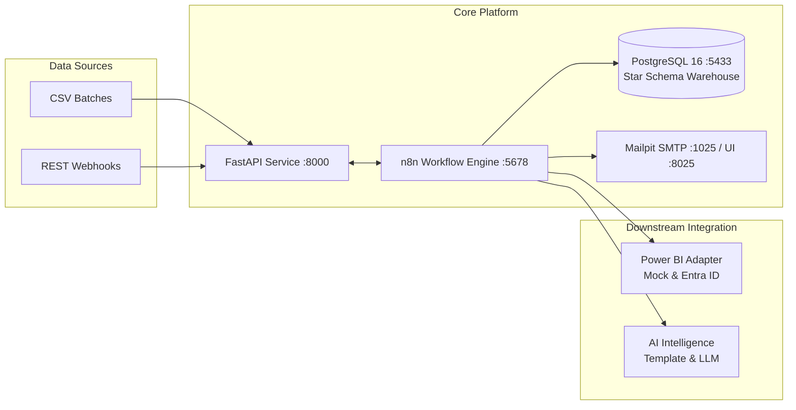

# Portfolio Case Study: Enterprise Intelligence Automation Platform (EIAP)

**Author:** Datta Sable  
**Portfolio:** [https://dattasable.com/](https://dattasable.com/)  
**GitHub Repository:** [https://github.com/sabledattatray/enterprise-n8n-intelligence-automation](https://github.com/sabledattatray/enterprise-n8n-intelligence-automation)  
**Role:** Principal Solution Architect & Lead Data/DevOps Engineer  
**Date:** October 2026  

---

## 1. Executive Summary

The Enterprise Intelligence Automation Platform (EIAP) is an open-source, production-style data engineering, business intelligence, and automated operations platform. 

Designed to showcase end-to-end modern data architecture, the platform automates the entire "Data-to-Decision" lifecycle: from raw multi-currency transactional ingestion and multi-tier data quality quarantine, through transactional star-schema warehouse loading in PostgreSQL 16, semantic BI synchronization with Microsoft Power BI, statistical KPI anomaly detection, hallucination-grounded AI executive briefings, and automated HTML report distribution with resilient failure recovery.

The platform was built from scratch without paid cloud dependencies, achieving 100% reproducible local execution via Docker Compose, 51 passing automated tests, sub-second API latencies, and 2.39-second isolated disaster recovery.

---

## 2. Business Problem

Modern enterprise organizations face severe operational friction at the boundaries between raw operational data, data warehouses, business intelligence tools, and executive communication:
1. **Disconnected Data Silos:** Data moves through brittle, unmonitored scripts where failure in one script cascades silently into inaccurate executive dashboards.
2. **Data Quality Blindspots:** Defective records (negative revenues, corrupt currency codes, duplicate orders) silently pollute analytics fact tables, causing data drift and loss of trust.
3. **Manual BI Refresh Overhead:** Power BI and Tableau dashboards require manual refresh orchestration or rigid schedules that run before ETL completes, serving stale data.
4. **Alert Fatigue & Un-grounded AI:** Traditional threshold alerts overwhelm operations teams, while unvetted LLM integrations hallucinate inaccurate financial metrics.
5. **Cascading Failure Storms:** Downstream transient network or database lock blips cause unmanaged retry storms that compound outages.

---

## 3. Solution Overview

EIAP resolves these operational bottlenecks through an integrated, event-driven orchestration architecture:

- **Automated Ingestion (WF01):** Validates batch content with SHA-256 fingerprinting, guaranteeing idempotent replay protection.
- **Deterministic Quality Quarantine (WF02):** Evaluates incoming records against strict precedence rules; clean data flows to ETL, defective records are safely isolated in `rejected_records`.
- **Atomic Dimensional ETL (WF03):** Implements parameterized SQL upserts into a clean star schema with zero duplicate rows.
- **Bi-Directional BI Sync (WF04):** Manages asynchronous Power BI refreshes with exponential backoff polling.
- **Statistical KPI Anomaly Engine (WF05):** Evaluates revenue and margin spikes against 30-day moving averages with 24-hour alert suppression.
- **Mathematically Grounded AI (WF06):** Synthesizes structured 7-section executive briefings, enforcing $\le 0.01\%$ numerical grounding verification before dispatch.
- **Automated HTML Distribution (WF07):** Formats responsive executive email briefings delivered via local Mailpit SMTP with dispatch idempotency.
- **Resilient Recovery (WF08):** Classifies failures (`TRANSIENT`, `AUTH`, `VALIDATION`), enforces scheduled exponential backoff with jitter, blocks premature retries (`HTTP 429`), and caps retries at 3 attempts.

---

## 4. System Architecture

---

## 5. Technology Selection & Rationale

| Layer | Technology | Decision Rationale |
| :--- | :--- | :--- |
| **Workflow Engine** | **n8n v1.82.2** | Node-based visual automation with code execution nodes, robust error handling, webhook triggers, and standalone task runners. |
| **Backend API** | **Python 3.12 + FastAPI 0.162** | High-performance ASGI framework, automatic OpenAPI documentation, Pydantic type safety, and native dependency injection. |
| **Analytics Warehouse** | **PostgreSQL 16 Alpine** | Robust relational capabilities, transactional ACID compliance, partial indexes, and window aggregation functions. |
| **Database Migrations**| **Alembic 1.14** | Version-controlled, reproducible schema migrations across environments. |
| **ORM & Driver** | **SQLAlchemy 2.0 + psycopg3** | Modern typed ORM with robust connection pooling and raw parameterized SQL support. |
| **Email Relay** | **Mailpit v1.23** | Zero-dependency local SMTP server with web UI, allowing full email testing without external spam risk. |
| **Containerization** | **Docker Compose v2** | One-command local environment reproduction on Windows, macOS, and Linux. |

---

## 6. Data Engineering Approach

The analytics warehouse uses a dimensional star schema:
- **Fact Table:** `fact_orders` (Grain: one row per product item in an external order).
- **Dimension Tables:** `dim_date` (surrogate `date_key`), `dim_product` (surrogate `product_key`), `dim_geography` (surrogate `geography_key`).
- **Composite Unique Grain:** `UNIQUE (source, external_order_id, product_key)` ensures idempotent ETL upserts.
- **Currency Isolation:** Every analytical aggregation enforces single-currency filtering (`WHERE currency_code = :currency`), completely avoiding invalid cross-currency additions.

---

## 7. Workflow Automation

Eight purpose-built n8n workflows orchestrate the lifecycle. All workflows:
- Parameterize credentials via `={{ $env.API_KEY }}` (zero plaintext secrets in JSON).
- Emit standardized correlation IDs for distributed tracing.
- Catch errors and route them to WF08 with detailed execution context.

---

## 8. BI and KPI Intelligence

- Parameterized SQL aggregation queries compute total revenue, cost, profit, gross margin %, total orders, average order value (AOV), and cancellation rates.
- Anomaly detection checks for deviations $> 20\%$ against 30-day historical moving averages.
- Built-in 24-hour suppression prevents alert fatigue during prolonged anomaly periods.

---

## 9. AI Grounding and Validation

To eliminate the risk of hallucinated executive guidance:
- AI prompts inject the exact materialized SQL KPI snapshot.
- The briefing generator formats a structured 7-section document.
- **Mathematical Grounding Guardrail:** Every metric in the text is extracted and compared against the database snapshot. If any value diverges $> 0.01\%$, the platform rejects the LLM output and automatically falls back to a deterministic, pre-verified template.

---

## 10. Operational Resilience

- **Failure Classifier:** Evaluates error codes and messages into `TRANSIENT`, `AUTH`, and `VALIDATION`.
- **Real Delayed Retries:** Transient incidents receive a scheduled backoff timestamp ($2.0 \times 2^{\text{attempt}} + \text{jitter}$).
- **Early Retry Rejection:** Calling `/delayed-retry` before the window elapses returns `HTTP 429 BACKOFF_ACTIVE`.
- **Bounded Cap:** Retries are strictly capped at 3 attempts before moving to `DEAD_LETTER`.

---

## 11. Security Engineering

- **Interface Isolation:** All Docker container ports bound strictly to `127.0.0.1`.
- **Zero Exposed Secrets:** Automated secret scanning (`scripts/verify_workflow_sanitization.py`) verifies zero secrets in git.
- **Supply Chain Hardened:** Dependency scanning via `pip-audit` confirms zero known CVEs.
- **STRIDE Threat Modeling:** Documented threat matrix covering spoofing, tampering, repudiation, information disclosure, denial of service, and elevation of privilege.

---

## 12. Testing Methodology

51 automated tests span contract, unit, and integration layers:
- **Contract Tests (4):** Verify data grain, numeric precision, and dimension schemas.
- **Unit Tests (9):** Verify API key validation, synthetic generator reproducibility, defect injection rates, and Pydantic schema validation.
- **Integration Tests (38):** Verify migrations, health endpoints, negative pipeline cases, Power BI mock lifecycles, KPI computation, anomaly detection, report dispatch, delayed retries, and database restore parity.

---

## 13. Verified Performance Results

All metrics obtained from automated benchmarks running on a 16GB developer workstation:
- **Core Endpoints p50:** 2.69ms (`/health/live`), 4.12ms (`/health/ready`), 5.51ms (`/anomalies/open`), 9.55ms (`/operations/health`).
- **PostgreSQL Aggregations (8.5k rows):** 3.23ms (Full fact aggregation), 2.59ms (3-way dimension join).
- **Concurrency:** Scaled to 10.04 req/s at C=10 workers with 100% success rate.
- **Pipeline Throughput:** 10,000 raw rows processed, validated, and loaded into facts in 5.58 seconds (1,792 rows/sec end-to-end).
- **Disaster Recovery RTO:** 2.39 seconds (Full restore and deep parity verification of 20,665 records).

---

## 14. Engineering Challenges & Solutions

| Challenge | Root Cause | Engineering Solution |
| :--- | :--- | :--- |
| **psycopg3 Ambiguous Typings** | Untyped null parameters in raw SQL queries caused PostgreSQL error `could not determine data type of parameter $2`. | Dynamically built dynamic `WHERE` clauses in `KPIService`, eliminating untyped null parameters. |
| **Dispatch Idempotency Grain** | Calling KPI computation inside `ReportService` materialized a new snapshot UUID on every call, breaking deduplication. | Added `materialize=False` parameter, allowing read-only breakdowns without mutating snapshot UUIDs. |
| **Premature Retry Storms** | Workers executing retries immediately undermined exponential backoff intervals. | Implemented time-aware delayed retry engine that rejects premature requests with `HTTP 429 BACKOFF_ACTIVE`. |
| **Cross-Currency Aggregation** | Summing revenues across USD, EUR, GBP, JPY, and SGD distorted financial reporting. | Enforced single-currency isolation at both the database query and API contract layers. |

---

## 15. Lessons Learned

1. **Deterministic Data Generation:** Building a fixed-seed synthetic data generator with controlled defect rates was crucial for building reliable, deterministic automated regression tests.
2. **Mock Ergonomics:** Investing early in robust local mock adapters for Power BI and AI services dramatically accelerated development and ensures reviewers never hit third-party subscription blockers.
3. **Automated Secret Verification:** Pre-commit scanning scripts are far more reliable than manual code reviews for keeping exported n8n workflows free of secrets.

---

## 16. Current Limitations

- **Single Host Scope:** Designed and verified for single-node local Docker development; multi-node Kubernetes clustering is outside the current scope.
- **Synthetic Data Demonstration:** All order events, customer names, and revenues are deterministically generated synthetic data for portfolio showcase purposes.

---

## 17. Future Enhancements

- Migration to n8n Queue Mode with Redis for horizontal task worker scaling.
- Native Apache Kafka / RabbitMQ ingress adapters for streaming real-time event ingestion.
- Pre-built Terraform modules for AWS (ECS + Aurora) and Azure (Container Apps + Flexible Server).

---

## 18. Author & Repository Links

- **Author Portfolio:** [https://dattasable.com/](https://dattasable.com/)
- **GitHub Repository:** [https://github.com/sabledattatray/enterprise-n8n-intelligence-automation](https://github.com/sabledattatray/enterprise-n8n-intelligence-automation)
- **LinkedIn / Professional Contact:** Available on [https://dattasable.com/](https://dattasable.com/)

