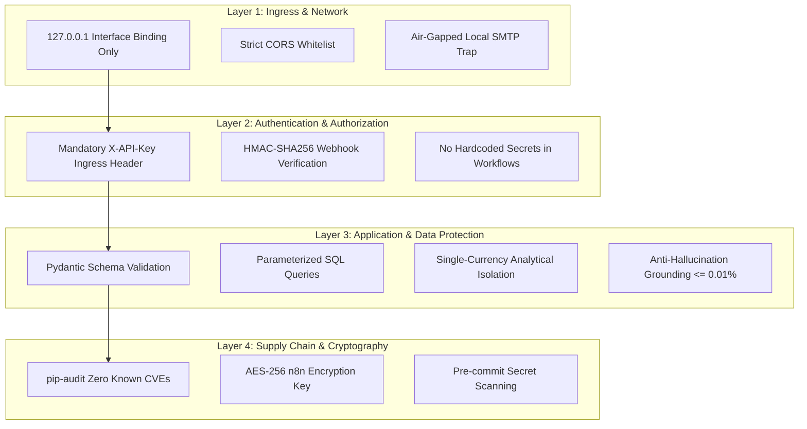

# Security Architecture & Standards: EIAP

**Document Version:** 1.0.0  
**Target Platform:** Enterprise n8n Intelligence Automation Platform  
**Author:** Datta Sable ([https://dattasable.com/](https://dattasable.com/))  
**Repository:** [https://github.com/sabledattatray/enterprise-n8n-intelligence-automation](https://github.com/sabledattatray/enterprise-n8n-intelligence-automation)  

---

## 1. Security Overview & Verified Posture

Security is engineered into every tier of the Enterprise Intelligence Automation Platform, from host interface binding to database column constraints and automated secret scanning.

Detailed security documentation:
- Threat Model: [`docs/security/STRIDE_THREAT_MODEL.md`](file:///d:/Datta%20Sable/N8N%20Project/docs/security/STRIDE_THREAT_MODEL.md)
- Security Audit Report: [`docs/security/SECURITY_AUDIT.md`](file:///d:/Datta%20Sable/N8N%20Project/docs/security/SECURITY_AUDIT.md)
- Credential Management Standard: [`docs/security/CREDENTIAL_MANAGEMENT.md`](file:///d:/Datta%20Sable/N8N%20Project/docs/security/CREDENTIAL_MANAGEMENT.md)
- Hardening Checklist: [`docs/security/HARDENING_CHECKLIST.md`](file:///d:/Datta%20Sable/N8N%20Project/docs/security/HARDENING_CHECKLIST.md)

---

## 2. Core Security Controls

---

## 3. Vulnerability Management

- **Automated Dependency Audits:** Verified via `pip-audit -r apps/api/requirements.txt` with zero known vulnerabilities.
- **Automated Secret Scanning:** Verified via `scripts/verify_workflow_sanitization.py`. All exported workflow JSON files in `workflows/` are verified free of plaintext API keys, database passwords, or private tokens.
- **Reporting Vulnerabilities:** Please review our [Security Policy](file:///d:/Datta%20Sable/N8N%20Project/SECURITY.md) for disclosure guidelines.

