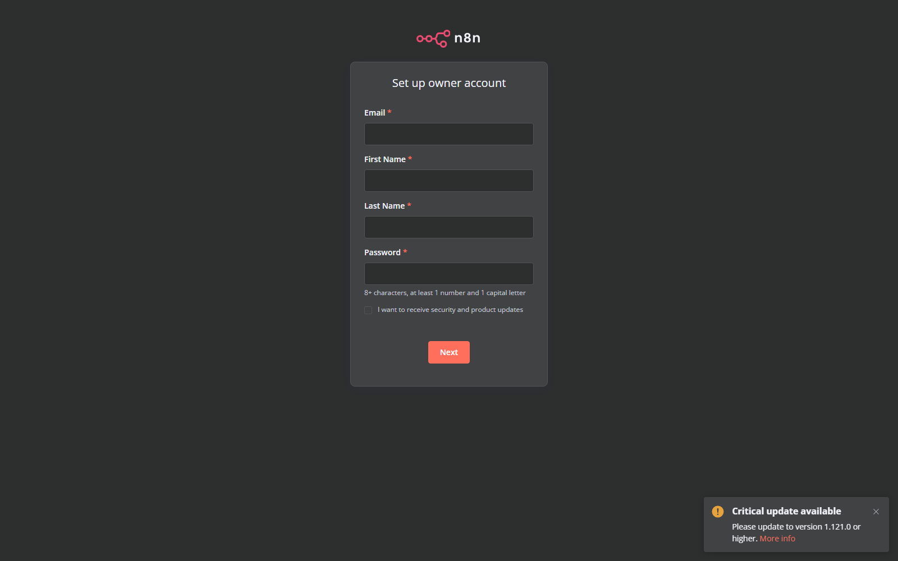

# Workflow Catalog: Enterprise Intelligence Automation Platform (EIAP)

**Document Version:** 1.0.0  
**Target Platform:** Enterprise n8n Intelligence Automation Platform (n8n v1.82.2)  
**Author:** Datta Sable ([https://dattasable.com/](https://dattasable.com/))  
**Repository:** [https://github.com/sabledattatray/enterprise-n8n-intelligence-automation](https://github.com/sabledattatray/enterprise-n8n-intelligence-automation)  

---

## Catalog Summary

| Workflow ID | Name | Trigger | Grain | Throughput | JSON Artifact |
| :--- | :--- | :--- | :--- | :--- | :--- |
| **WF01** | Enterprise Data Ingestion | Webhook / Manual / Schedule | Raw Batch | 8,196 rows/s | [`01-data-ingestion.json`](file:///d:/Datta%20Sable/N8N%20Project/workflows/01-data-ingestion.json) |
| **WF02** | Enterprise Data Quality Engine | Automated Ingestion Event | Record | 5,434 rows/s | [`02-data-quality.json`](file:///d:/Datta%20Sable/N8N%20Project/workflows/02-data-quality.json) |
| **WF03** | Enterprise SQL ETL Pipeline | Automated Validation Event | Dim/Fact | 4,739 rows/s | [`03-sql-etl.json`](file:///d:/Datta%20Sable/N8N%20Project/workflows/03-sql-etl.json) |
| **WF04** | Power BI Refresh Orchestrator | Post-ETL / Webhook | Dataset | Async Polled | [`04-powerbi-refresh.json`](file:///d:/Datta%20Sable/N8N%20Project/workflows/04-powerbi-refresh.json) |
| **WF05** | KPI Monitoring & Anomaly Alert | Post-Refresh / Hourly | Daily / 30-Day | 47.60 ms | [`05-kpi-monitoring.json`](file:///d:/Datta%20Sable/N8N%20Project/workflows/05-kpi-monitoring.json) |
| **WF06** | Grounded AI Executive Intelligence | Post-Anomaly / Manual | KPI Snapshot | 14.57 ms | [`06-ai-insights.json`](file:///d:/Datta%20Sable/N8N%20Project/workflows/06-ai-insights.json) |
| **WF07** | Automated Report Distribution | Daily 08:00 UTC / Anomaly | Briefing | < 1 second | [`07-report-distribution.json`](file:///d:/Datta%20Sable/N8N%20Project/workflows/07-report-distribution.json) |
| **WF08** | Operational Failure & Recovery | Error Trigger / Webhook | Incident | Bounded Backoff | [`08-failure-recovery.json`](file:///d:/Datta%20Sable/N8N%20Project/workflows/08-failure-recovery.json) |

---

## Detailed Workflow Specifications

### WF01 — Enterprise Data Ingestion
- **ID:** `F7MPVLjpUs6Lg176`
- **Business Purpose:** Ingests high-volume multi-currency order events from CSV files or REST API payloads, computes SHA-256 batch fingerprints, detects replay attempts, and stages raw records.
- **Trigger:** Webhook (`POST /webhook/ingestion`), Manual, or Cron schedule.
- **Input Contract:** JSON body with `file_path` or raw records array.
- **Main Processing Steps:**
  1. Calculate SHA-256 content hash of the batch.
  2. Check `ingestion_runs` table for duplicate hash.
  3. If duplicate detected, return `HTTP 200` with `IDEMPOTENT_REPLAY` and abort.
  4. Chunk records into bounded sub-batches (1,000 rows).
  5. Bulk insert into `raw_orders` staging table with status `PENDING`.
- **Output Contract:** `{ "run_id": "...", "status": "COMPLETED", "records_ingested": 10000, "content_sha256": "..." }`.
- **Database Dependencies:** `ingestion_runs`, `raw_orders`.
- **Failure Handling:** HTTP 5xx errors emit failure webhook to WF08.
- **Screenshot:** 

---

### WF02 — Enterprise Data Quality Engine
- **ID:** `0QPJC0JWGAJL4c9F`
- **Business Purpose:** Evaluates incoming order records against strict data quality rules, deterministically isolating defective records into quarantine without halting the batch.
- **Trigger:** Automated trigger from WF01 completion or direct API request.
- **Validation Precedence Hierarchy:**
  1. *Required Fields:* Missing external ID, date, product code, currency.
  2. *Data Types:* Unparseable dates, non-numeric prices.
  3. *Business Values:* Negative quantities ($< 1$), invalid ISO currencies (`XYZ`).
  4. *Referential Integrity:* Unrecognized product codes or geography codes.
- **Output Contract:** `{ "accepted_count": 8564, "rejected_count": 937, "duplicate_count": 499 }`.
- **Database Dependencies:** `raw_orders`, `rejected_records`, `validation_rules`.
- **Screenshot:** 

---

### WF03 — Enterprise SQL ETL Pipeline
- **ID:** `1M6IK2WjiYLBeALM`
- **Business Purpose:** Loads validated dimension tables and performs atomic, parameterized upserts into the `fact_orders` star-schema warehouse.
- **Trigger:** Automated trigger from WF02 completion.
- **Processing Steps:**
  1. Transactional dimension resolution for `dim_date`, `dim_product`, and `dim_geography`.
  2. Map surrogate integer keys (`date_key`, `product_key`, `geography_key`).
  3. Atomic upsert: `INSERT INTO fact_orders ... ON CONFLICT (source, external_order_id, product_key) DO UPDATE`.
  4. Update `ingestion_runs` status to `LOADED`.
- **Database Dependencies:** `dim_date`, `dim_product`, `dim_geography`, `fact_orders`.
- **Screenshot:** 

---

### WF04 — Power BI Refresh Orchestrator
- **ID:** `4AkDn4edzfMayzfd`
- **Business Purpose:** Orchestrates semantic dataset refreshes in Power BI, polling execution status with bounded exponential backoff.
- **Trigger:** Automated trigger from WF03 completion or manual trigger.
- **Adapter Mechanism:**
  - *Default:* Verified local mock adapter emulating Entra ID token issuance and asynchronous refresh lifecycle.
  - *Production:* Microsoft Power BI REST API (`https://api.powerbi.com/v1.0/myorg/groups/{groupId}/datasets/{datasetId}/refreshes`).
- **Failure Handling:** Timeouts (> 180s) or Entra ID auth failures route to WF08.
- **Screenshot:** 

---

### WF05 — KPI Monitoring & Anomaly Detection
- **ID:** `AEwe0Mqq2s3ibDkg`
- **Business Purpose:** Calculates enterprise KPIs via single-currency parameterized SQL queries and detects statistical deviations exceeding 20% vs 30-day moving averages.
- **Trigger:** Hourly cron or post-refresh webhook.
- **Anomaly Rules:**
  - `ANOM_REVENUE_SPIKE`: $>20\%$ deviation above 30-day baseline.
  - `ANOM_MARGIN_DROP`: Gross margin drops below $15\%$.
  - `ANOM_CANCELLATION`: Order cancellation rate exceeds $10\%$.
- **Alert Suppression:** Dynamic 24-hour suppression prevents alert storms for sustained anomalies.
- **Screenshot:** 

---

### WF06 — Grounded AI Executive Intelligence
- **ID:** `ZqOB7RDye7ig6FeN`
- **Business Purpose:** Synthesizes structured 7-section executive briefings grounded directly in SQL analytics, enforcing mathematical anti-hallucination verification.
- **Trigger:** Automated trigger from WF05 anomaly detection or manual trigger.
- **The 7 Briefing Sections:**
  1. Executive Summary & Period Performance
  2. Revenue & Profitability Analysis
  3. Regional & Geographic Distribution
  4. Product Category Breakdown
  5. Anomaly Diagnosis & Root Cause
  6. Operational & Financial Risks
  7. Strategic Recommendations
- **Anti-Hallucination Guardrail:** All numerical citations must match database values within $\le 0.01\%$ tolerance. Violations trigger automatic fallback to deterministic templates.
- **Screenshot:** 

---

### WF07 — Automated Report Distribution
- **ID:** `TAayFWnDcGPbmFyd`
- **Business Purpose:** Generates responsive, executive-styled HTML email reports and delivers them via SMTP.
- **Trigger:** Daily at 08:00 UTC or upon critical anomaly event.
- **Dispatch Idempotency:** Tracks dispatches via `(report_id, recipient_hash)`. Duplicate dispatch attempts return `HTTP 200` with `ALREADY_DISPATCHED`.
- **Delivery Harness:** Local Mailpit test SMTP relay on `127.0.0.1:1025`.
- **Screenshot:** 

---

### WF08 — Centralized Failure Recovery & Incident Management
- **ID:** `zLsQ98U2iaRhwhG9`
- **Business Purpose:** Catches pipeline errors, classifies failure categories, enforces exponential backoff with jitter, rejects premature retries with HTTP 429, and quarantines persistent failures in `DEAD_LETTER`.
- **Trigger:** Global n8n Error Trigger or `POST /v1/operations/incidents`.
- **Max Retries:** Capped at 3 attempts.
- **Screenshot:** 

