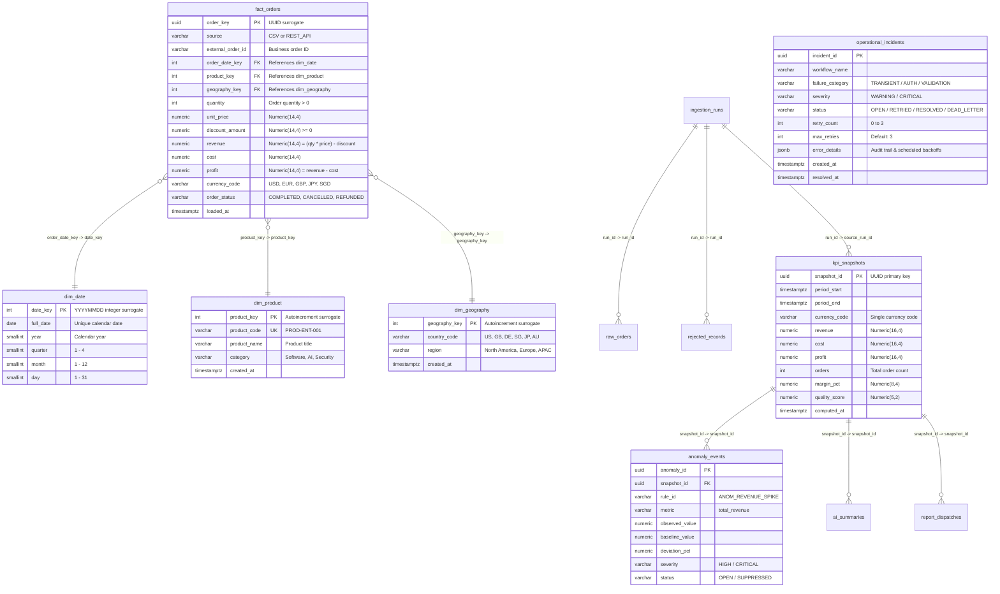

# Data Architecture & Star Schema Model: EIAP

**Document Version:** 1.0.0  
**Target Platform:** Enterprise n8n Intelligence Automation Platform  
**Author:** Datta Sable ([https://dattasable.com/](https://dattasable.com/))  
**Repository:** [https://github.com/sabledattatray/enterprise-n8n-intelligence-automation](https://github.com/sabledattatray/enterprise-n8n-intelligence-automation)  

---

## 1. Relational Star Schema Entity Relationship Diagram

The analytical warehouse (`business_analytics`) employs a dimensional star schema optimized for fast analytical aggregations, financial precision, and referential integrity.



---

## 2. Dimensional Grain & Integrity Constraints

### 1. Fact Table Grain
- **Grain:** One row per individual product item within an external business order event.
- **Uniqueness Constraint (`uq_fact_orders_grain`):**
  ```sql
  UNIQUE (source, external_order_id, product_key)
  ```
  Guarantees that re-running ingestion or ETL pipelines cannot produce duplicate fact rows. Subsequent deliveries execute idempotent `ON CONFLICT DO UPDATE`.

### 2. Strict Currency Isolation
To prevent financial distortion caused by summing across distinct exchange rates:
- `fact_orders` records the currency code directly on every transaction (`USD`, `EUR`, `GBP`, `JPY`, `SGD`).
- All analytical aggregations in `kpi_snapshots` enforce single-currency isolation:
  ```sql
  WHERE f.currency_code = :currency
  ```
- Cross-currency aggregations are strictly prevented at both the database layer and the API contract layer.

### 3. Referential Integrity & Foreign Keys
- `fact_orders.order_date_key` $\to$ `dim_date.date_key`
- `fact_orders.product_key` $\to$ `dim_product.product_key`
- `fact_orders.geography_key` $\to$ `dim_geography.geography_key`
- `anomaly_events.snapshot_id` $\to$ `kpi_snapshots.snapshot_id` (ON DELETE CASCADE)
- `rejected_records.run_id` $\to$ `ingestion_runs.run_id`

