# End-to-End Data Pipeline Architecture: EIAP

**Document Version:** 1.0.0  
**Target Platform:** Enterprise n8n Intelligence Automation Platform  
**Author:** Datta Sable ([https://dattasable.com/](https://dattasable.com/))  
**Repository:** [https://github.com/sabledattatray/enterprise-n8n-intelligence-automation](https://github.com/sabledattatray/enterprise-n8n-intelligence-automation)  

---

## 1. End-to-End Pipeline Data Flow

The platform executes a multi-stage, idempotent data processing lifecycle: from raw file/webhook ingestion, through schema and value validation, transactional star-schema loading, semantic BI refresh, statistical anomaly detection, AI intelligence synthesis, and executive report delivery.

```mermaid
flowchart TD
    subgraph Stage 1: Ingestion WF01
        RAW_IN[Raw Order Batch<br/>CSV / REST API Payload]
        HASH[Compute SHA-256 Digest]
        CHK_RUN{Duplicate Hash<br/>in ingestion_runs?}
        STG[(Stage into raw_orders<br/>Status: PENDING)]
        IDEM_EXIT[Return IDEMPOTENT_REPLAY<br/>Skip Execution]
    end

    subgraph Stage 2: Quality Engine WF02
        VAL_RULES[Multi-Tier Validation Rules<br/>1. Required Fields<br/>2. Data Types<br/>3. Format / Values<br/>4. Referential Integrity]
        PRE_EVAL{Valid Record?}
        QUAR[(Insert into rejected_records<br/>Status: QUARANTINED)]
        CLEAN[Accepted Records<br/>Status: VALIDATED]
    end

    subgraph Stage 3: SQL ETL Engine WF03
        DIM_LOAD[Transactional Dimension Loading<br/>dim_date, dim_product, dim_geography]
        FACT_UPSERT[Parameterized Fact Table Upsert<br/>ON CONFLICT uq_fact_orders_grain<br/>DO UPDATE]
        WAREHOUSE[(fact_orders<br/>Clean Analytics Grain)]
    end

    subgraph Stage 4: BI Sync WF04
        PBI_TRIGGER[Trigger Dataset Refresh]
        PBI_POLL{Poll Refresh Status<br/>Bounded Backoff}
        PBI_DONE[Dataset Synchronized]
    end

    subgraph Stage 5: KPI & Anomaly Engine WF05
        SQL_AGG[Compute Parameterized KPIs<br/>Single Currency Isolation]
        KPI_SNAP[(Persist kpi_snapshots)]
        ANOM_EVAL{Deviation > 20% vs<br/>30-Day Moving Average?}
        SUPPR{Alerted within 24h?}
        ANOM_EVENT[(Persist anomaly_events)]
    end

    subgraph Stage 6: AI Intelligence WF06
        AI_GEN[Synthesize 7-Section Briefing]
        GUARD{Mathematical Grounding<br/>Matches Snapshot <= 0.01%?}
        AI_DOC[(Persist ai_summaries)]
        AI_FALLBACK[Fallback to Deterministic Template]
    end

    subgraph Stage 7: Report Distribution WF07
        RENDER[Render Responsive HTML Briefing]
        DISP_CHK{Dispatched for<br/>report_id + recipient?}
        SMTP[Dispatch via Mailpit SMTP :1025]
        DISP_LOG[(Persist report_dispatches)]
    end

    RAW_IN --> HASH
    HASH --> CHK_RUN
    CHK_RUN -->|Yes| IDEM_EXIT
    CHK_RUN -->|No| STG
    STG --> VAL_RULES

    VAL_RULES --> PRE_EVAL
    PRE_EVAL -->|No| QUAR
    PRE_EVAL -->|Yes| CLEAN

    CLEAN --> DIM_LOAD
    DIM_LOAD --> FACT_UPSERT
    FACT_UPSERT --> WAREHOUSE

    WAREHOUSE --> PBI_TRIGGER
    PBI_TRIGGER --> PBI_POLL
    PBI_POLL -->|COMPLETED| PBI_DONE

    PBI_DONE --> SQL_AGG
    SQL_AGG --> KPI_SNAP
    KPI_SNAP --> ANOM_EVAL

    ANOM_EVAL -->|Yes| SUPPR
    SUPPR -->|No| ANOM_EVENT
    ANOM_EVAL -->|No| AI_GEN
    SUPPR -->|Yes| AI_GEN

    ANOM_EVENT --> AI_GEN
    AI_GEN --> GUARD
    GUARD -->|Pass| AI_DOC
    GUARD -->|Fail| AI_FALLBACK --> AI_DOC

    AI_DOC --> RENDER
    RENDER --> DISP_CHK
    DISP_CHK -->|No| SMTP
    SMTP --> DISP_LOG
```

---

## 2. Pipeline Stage Characteristics

| Stage | Workflow ID | Execution Trigger | Grain / Batch Size | Throughput | Persistence Target |
| :--- | :--- | :--- | :--- | :--- | :--- |
| **Ingestion** | `WF01` | Webhook / Manual / Schedule | 1,000 - 10,000 records | **8,196 rows/s** | `raw_orders`, `ingestion_runs` |
| **Quality** | `WF02` | Automated on Ingestion | Individual Order Record | **5,434 rows/s** | `rejected_records` |
| **SQL ETL** | `WF03` | Automated on Validation | Dimension & Fact Grain | **4,739 rows/s** | `fact_orders`, Dimensions |
| **Power BI Refresh** | `WF04` | Post-ETL Completion | Dataset Partition | Polled Async (1.5x backoff) | `integration_events` |
| **KPI Monitoring** | `WF05` | Post-Refresh / Hourly | Daily / 30-Day Aggregation | 47.60 ms / snapshot | `kpi_snapshots`, `anomaly_events` |
| **AI Intelligence** | `WF06` | Post-KPI Anomaly Detection | Single KPI Snapshot | 14.57 ms / summary | `ai_summaries` |
| **Report Distribution**| `WF07` | Daily 08:00 UTC / Anomaly | Single Executive Briefing | Sub-second SMTP delivery | `report_dispatches` |
| **Failure Recovery** | `WF08` | Error Webhook / Manual | Incident Grain | Jittered Backoff ($2\times$) | `operational_incidents` |

