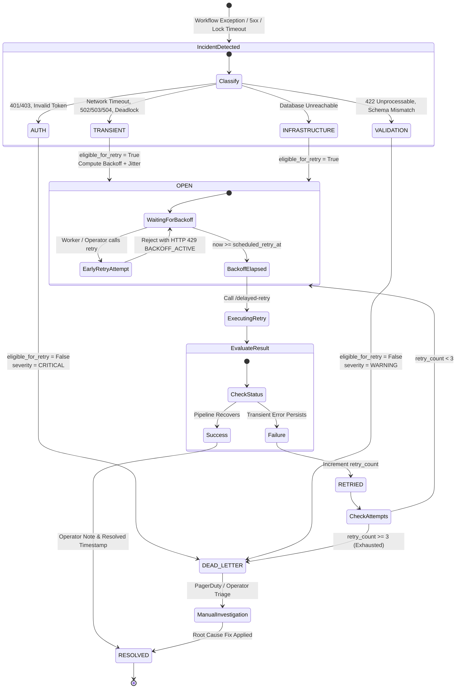

# Failure Recovery & Operational Incident Lifecycle: EIAP

**Document Version:** 1.0.0  
**Target Platform:** Enterprise n8n Intelligence Automation Platform  
**Author:** Datta Sable ([https://dattasable.com/](https://dattasable.com/))  
**Repository:** [https://github.com/sabledattatray/enterprise-n8n-intelligence-automation](https://github.com/sabledattatray/enterprise-n8n-intelligence-automation)  

---

## 1. Operational Incident State Machine

The platform implements automated failure triage, classification, and backoff enforcement to handle transient downstream blips without infinite loops or retry storms.



---

## 2. Failure Classification Matrix

| Category | HTTP / System Codes | Retryable? | Severity | Backoff Schedule | Quarantine Action |
| :--- | :--- | :--- | :--- | :--- | :--- |
| **TRANSIENT** | `502`, `503`, `504`, `PG_LOCK_TIMEOUT`, `ECONNRESET` | **Yes** | `WARNING` | Base $2.0 \times 2^{\text{attempt}} + \text{jitter}$ (0.5s - 2.0s) | Retried up to 3 times before moving to `DEAD_LETTER` |
| **AUTH** | `401 Unauthorized`, `403 Forbidden`, `INVALID_KEY` | **No** | `CRITICAL` | None (Refuses retry) | Immediate isolation to `DEAD_LETTER` |
| **VALIDATION** | `422 Unprocessable`, `SCHEMA_VIOLATION` | **No** | `WARNING` | None (Refuses retry) | Immediate isolation to `DEAD_LETTER` |
| **INFRASTRUCTURE** | Container OOM, Host Port Unreachable | **Yes** | `CRITICAL` | Linear 30s delay | Capped at 2 retries |

---

## 3. Real Backoff Timing Verification

The delayed retry engine was verified with live timing assertions in [`scripts/verify_real_delayed_retry.py`](file:///d:/Datta%20Sable/N8N%20Project/scripts/verify_real_delayed_retry.py):
1. **Immediate Retry Rejection ($t = 0.2\text{s}$):**
   ```text
   HTTP Status: 429
   [OK] Early Retry Blocked: BACKOFF_ACTIVE -> Retry rejected: Backoff interval has not elapsed yet.
   Scheduled for 2026-10-29T07:55:09.368077+00:00 (2.27s remaining). Refusing early retry.
   ```
2. **Post-Backoff Acceptance ($t = 3.46\text{s}$):**
   ```text
   [OK] Retry Attempt: 1/3
   [OK] New Status: RETRIED
   [OK] Correlation ID: corr_delayed_retry_verification
   ```
3. **Max Retry Quarantine:**
   Attempting a 4th retry returns `HTTP 400 Bad Request` and transitions status to `DEAD_LETTER`.

