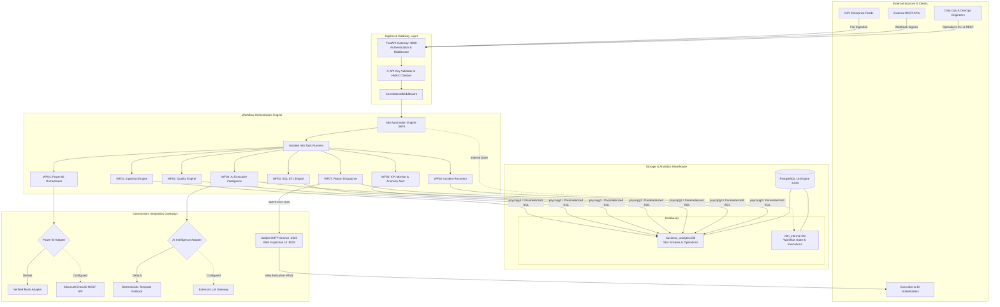

# Platform Architecture: Enterprise Intelligence Automation Platform (EIAP)

**Document Version:** 1.0.0  
**Target Platform:** Enterprise n8n Intelligence Automation Platform  
**Author:** Datta Sable ([https://dattasable.com/](https://dattasable.com/))  
**Repository:** [https://github.com/sabledattatray/enterprise-n8n-intelligence-automation](https://github.com/sabledattatray/enterprise-n8n-intelligence-automation)  

---

## 1. System Topology & Integration Boundaries

The Enterprise Intelligence Automation Platform (EIAP) is an enterprise-grade, event-driven data engineering, business intelligence, and automated operations platform. The entire stack runs within reproducible, isolated Docker containers pinned to localhost (`127.0.0.1`), requiring zero paid cloud dependencies for full functional verification.

---

## 2. Core Architectural Pillars

### 1. Decoupled Service Isolation
- **Microservices Stack:** Managed via `docker-compose.yml` with strict health check probes (`/health/live`, `pg_isready`).
- **Network Boundaries:** All container ports (`8000`, `5678`, `5433`, `8025`, `1025`) bind explicitly to `127.0.0.1`, completely preventing local area network or WAN ingress.
- **Port Non-Interference:** PostgreSQL uses host port `5433`, preventing collision with native Windows PostgreSQL on `5432`.

### 2. Dual Database Segregation
- `business_analytics`: Contains raw staging, validation quarantine, star schema (`fact_orders`, dimensions), KPI snapshots, anomaly events, report dispatches, and incident logs.
- `n8n_internal`: Houses n8n user sessions, encrypted workflow configurations, and task execution history.

### 3. End-to-End Traceability
- Every HTTP request, task execution, and automated retry carries an immutable `X-Correlation-ID` header.
- Correlated audit logs enable exact forensic investigation from webhook trigger to database upsert and email delivery.

### 4. Zero-Cost Developer Ergonomics
- The entire platform can be cloned and run on any developer machine (Windows, macOS, Linux) with Docker Desktop.
- Mock adapters for Power BI and AI services ensure that reviewers never encounter paywalls, expired API keys, or cloud subscription blockers.

