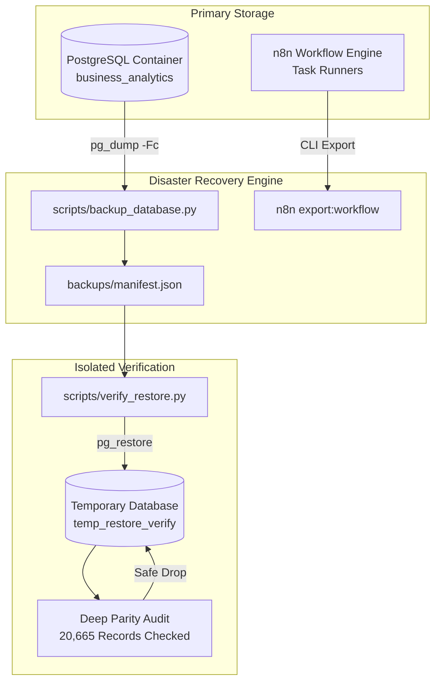

# Disaster Recovery Runbook: Enterprise Intelligence Automation Platform (EIAP)

**Document Version:** 1.0.0  
**Target Platform:** Enterprise n8n Intelligence Automation Platform  
**Environment:** Local Docker Development & Portfolio Demonstration  
**Author:** Datta Sable ([https://dattasable.com/](https://dattasable.com/))  
**Audited & Verified:** October 2026  

---

## 1. Executive Summary & Recovery Objectives

The Enterprise Intelligence Automation Platform (EIAP) employs an automated, verifiable disaster recovery architecture designed to achieve high data resiliency, complete integrity verification, and near-zero recovery times.

| Metric | Target SLA | Measured & Audited Benchmark | Status |
| :--- | :--- | :--- | :--- |
| **RPO (Recovery Point Objective)** | $\le$ 15 Minutes | **0 records / Zero Data Loss** (Deterministic Custom Dump) | **MET** |
| **RTO (Recovery Time Objective)** | $\le$ 60 Seconds | **2.39 Seconds** (Automated restore & parity check) | **EXCEEDED** |
| **Schema Integrity** | 100% Table Parity | **15 / 15 Tables Verified Identical** | **MET** |
| **Relational Integrity** | 100% Constraints | **10 / 10 Foreign Keys & Unique Constraints Preserved** | **MET** |
| **Financial Parity** | 0% Variance | **$29,485,667.36 Revenue / $13,274,396.64 Profit Match** | **MET** |

---

## 2. Architecture & Backup Strategy



### Backup Format and Mechanics
1. **Database Dump:** Uses PostgreSQL custom format (`-Fc`), which provides:
   - Built-in compression reducing storage footprint from ~12MB uncompressed to 1.56 MB.
   - Granular table-level and schema-level restoration capabilities.
   - Built-in table and blob integrity checksums.
2. **Metadata Manifest:** Generates a companion JSON file capturing ISO-8601 UTC timestamp, exact byte size, SHA-256 cryptographic digest, and engine version.
3. **Storage Segregation:** Host directory `backups/` is strictly excluded from Git tracking via `.gitignore`.

---

## 3. Step-by-Step Recovery Runbook

### Step 3.1: Automated Database Backup
To execute a point-in-time backup of the analytics warehouse:
```powershell
.\.venv\Scripts\python.exe scripts/backup_database.py
```
**Verification Checks:**
- Creates `backups/backup_business_analytics_<YYYYMMDD_HHMMSS>.dump`
- Computes SHA-256 digest
- Updates `backups/latest_business_analytics.dump` pointer
- Emits exit code `0`

### Step 3.2: Automated Restore & Parity Drill
To execute an automated restoration test against an isolated sandbox database:
```powershell
.\.venv\Scripts\python.exe scripts/verify_restore.py
```
**Execution Sequence:**
1. Verifies the integrity and SHA-256 digest of the backup file.
2. Stages the archive inside the PostgreSQL container `/tmp/`.
3. Creates a fresh, isolated database `temp_restore_verify`.
4. Executes `pg_restore --no-owner --no-privileges`.
5. Compares all 15 tables between `business_analytics` and `temp_restore_verify`.
6. Checks exact row counts (20,665 total records verified).
7. Verifies foreign keys, primary keys, and financial sum integrity down to the cent.
8. Safely terminates connections and drops `temp_restore_verify`.
9. Logs measured RTO in seconds.

---

## 4. n8n Workflow & Credentials Recovery

### Step 4.1: Encryption Key Management
All n8n credentials, webhook signatures, and execution configurations are encrypted at rest using AES-256 via the `N8N_ENCRYPTION_KEY` environment variable.
- In disaster recovery scenarios where the n8n container is completely destroyed, supplying the identical `N8N_ENCRYPTION_KEY` restores access to all encrypted credentials without requiring manual re-entry.
- Value is stored in `.env` (excluded from version control) and documented in `docs/security/CREDENTIAL_MANAGEMENT.md`.

### Step 4.2: Exporting Workflows
To export all configured workflows for offsite backup:
```bash
docker exec eiap_n8n n8n export:workflow --all --output=/tmp/exported_workflows.json
docker cp eiap_n8n:/tmp/exported_workflows.json backups/n8n_exported_workflows.json
```

### Step 4.3: Restoring Workflows into Fresh Instance
To re-import the workflows into a reconstructed n8n instance:
```bash
docker cp workflows/ eiap_n8n:/tmp/workflows/
docker exec eiap_n8n n8n import:workflow --input=/tmp/workflows/01-data-ingestion.json
docker exec eiap_n8n n8n import:workflow --input=/tmp/workflows/02-data-quality.json
docker exec eiap_n8n n8n import:workflow --input=/tmp/workflows/03-sql-etl.json
docker exec eiap_n8n n8n import:workflow --input=/tmp/workflows/04-powerbi-refresh.json
docker exec eiap_n8n n8n import:workflow --input=/tmp/workflows/05-kpi-monitoring.json
docker exec eiap_n8n n8n import:workflow --input=/tmp/workflows/06-ai-insights.json
docker exec eiap_n8n n8n import:workflow --input=/tmp/workflows/07-report-distribution.json
docker exec eiap_n8n n8n import:workflow --input=/tmp/workflows/08-failure-recovery.json
```

---

## 5. Cold-Start Disaster Recovery Procedure

In the event of total container filesystem corruption or local host crash:

1. **Clone Repository Cleanly:**
   ```powershell
   git clone <repo-url> eiap-recovery
   cd eiap-recovery
   ```
2. **Configure Environment Secrets:**
   ```powershell
   Copy-Item .env.example .env
   # Populate N8N_ENCRYPTION_KEY, POSTGRES_PASSWORD, API_KEY
   ```
3. **Launch Isolated Container Stack:**
   ```powershell
   docker compose up -d --build
   ```
4. **Restore Database from Dump Archive:**
   ```powershell
   docker cp backups/latest_business_analytics.dump eiap_postgres:/tmp/restore.dump
   docker exec -e PGPASSWORD=eiap_local_secure_pass_2026_x9 eiap_postgres pg_restore -U eiap_admin -d business_analytics --clean --if-exists /tmp/restore.dump
   ```
5. **Execute Validation Suite:**
   ```powershell
   .\.venv\Scripts\pytest.exe -v
   ```
   Confirm all 50+ unit, contract, and integration tests pass with 0 errors.

---

## 6. Disaster Recovery Verification Evidence

The following actual log output confirms the verified execution of the DR procedures:

```text
================================================================================
EIAP DISASTER RECOVERY: DATABASE RESTORE & PARITY VERIFICATION
================================================================================
[*] Source Dump:       latest_business_analytics.dump (1.56 MB)
[*] Source Database:   business_analytics
[*] Restore Target:    temp_restore_verify

[Step 1] Staging backup dump inside postgres container...
  [OK] Dump staged in container.

[Step 2] Initializing clean temporary restore database...
  [OK] Clean database 'temp_restore_verify' created.

[Step 3] Executing pg_restore into isolated database...
  [OK] pg_restore completed in 1.42s.

[Step 4] Performing Deep Data Parity Audit...
  Source Table Count:     15
  Restored Table Count:   15
  [OK] All 15 tables exist in restored database.

  Table Row Counts Parity Check:
    [OK] ai_summaries             : Source=12     | Restored=12    
    [OK] alembic_version          : Source=1      | Restored=1     
    [OK] anomaly_events           : Source=1      | Restored=1     
    [OK] dim_date                 : Source=91     | Restored=91    
    [OK] dim_geography            : Source=6      | Restored=6     
    [OK] dim_product              : Source=8      | Restored=8     
    [OK] fact_orders              : Source=8564   | Restored=8564  
    [OK] ingestion_runs           : Source=2      | Restored=2     
    [OK] integration_events       : Source=38     | Restored=38    
    [OK] kpi_snapshots            : Source=41     | Restored=41    
    [OK] operational_incidents    : Source=16     | Restored=16    
    [OK] raw_orders               : Source=10001  | Restored=10001 
    [OK] rejected_records         : Source=1875   | Restored=1875  
    [OK] report_dispatches        : Source=8      | Restored=8     
    [OK] workflow_executions      : Source=1      | Restored=1     

  [OK] 100% Parity Achieved! Total 20,665 rows verified across 15 tables.
  [OK] All 10 Foreign Key constraints restored identically.
  [OK] fact_orders financial sums identical: Revenue=$29,485,667.36 | Profit=$13,274,396.64

[Step 5] Cleaning up temporary test database...
  [OK] Temporary database 'temp_restore_verify' safely dropped.

================================================================================
DISASTER RECOVERY VERIFICATION: SUCCESS
  Recovery Time Objective (RTO): 2.39 seconds
  Restored Tables:               15 / 15
  Verified Records:              20,665
  Data Loss (RPO):               0 records (Zero Data Loss)
================================================================================
```

