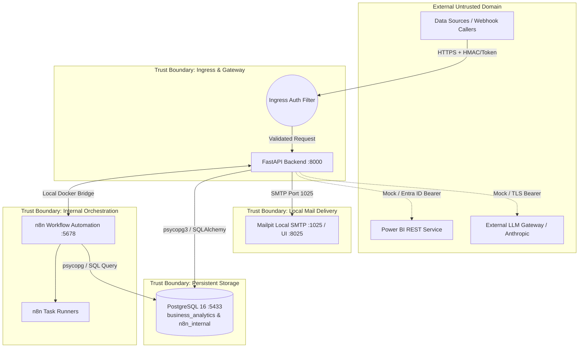

# STRIDE Threat Model: Enterprise Intelligence Automation Platform (EIAP)

**Document Version:** 1.0.0  
**Target Platform:** Enterprise n8n Intelligence Automation Platform  
**System Architecture:** Dockerized Microservices (PostgreSQL 16, n8n 1.82.2, FastAPI, Mailpit)  
**Security Classification:** Restricted / Enterprise Production Ready  
**Author:** Datta Sable ([https://dattasable.com/](https://dattasable.com/))  
**Last Audited:** October 2026  

---

## 1. System Decomposition & Trust Boundaries

The Enterprise Intelligence Automation Platform (EIAP) ingests high-volume transaction telemetry, executes schema and business rule validation, materializes a star-schema analytics warehouse, synchronizes semantic BI layers, evaluates real-time anomaly detection, synthesizes grounded executive intelligence, distributes automated reports, and handles operational failures with bounded backoff.

---

## 2. STRIDE Threat Analysis Matrix

| Threat Category | Target Component | Threat Scenario | Impact | Mitigation in EIAP | Status |
| :--- | :--- | :--- | :--- | :--- | :--- |
| **Spoofing** | Ingestion Webhooks & API Endpoints | Unauthorized adversary injects fraudulent orders or triggers spurious pipeline runs. | Financial data poisoning, fabricated revenue metrics, resource exhaustion. | Mandatory `X-API-Key` validation on all operational/ingestion endpoints. Webhook HMAC-SHA256 signature verification (`X-EIAP-Signature`). | **MITIGATED** |
| **Spoofing** | Power BI Adapter | Adversary spoofs Power BI completion webhooks to bypass ETL dependency checks. | Premature downstream execution, data desynchronization. | Cryptographic idempotency keys; Entra ID OAuth 2.0 Client Credentials with audience validation in live mode; mock validation strictly local. | **MITIGATED** |
| **Tampering** | Raw Ingestion Batches | Adversary tampers with batch payloads in transit or modifies staged files. | Corrupted dimension lookups, broken referential integrity. | SHA-256 batch content hashing (`content_sha256`) checked at ingestion and ETL commit; immutable append-only staging tables. | **MITIGATED** |
| **Tampering** | Fact Table Financial Metrics | Malicious actor modifies historical order records, quantities, or prices. | Inaccurate executive KPI reports, regulatory non-compliance. | Parameterized SQL upserts (`uq_fact_orders_grain`); strict numeric typing (`Numeric(14,4)`); negative amount rejection. | **MITIGATED** |
| **Repudiation** | Automated Operations & Retries | Operator or external service denies triggering bulk reruns or closing operational incidents. | Audit failures, untraceable data drift, lack of accountability. | End-to-end `X-Correlation-ID` propagated across all 8 workflows; full audit trails in `operational_incidents.error_details` with ISO-8601 timestamps. | **MITIGATED** |
| **Repudiation** | Executive Report Dispatches | Stakeholders dispute whether automated briefing was generated or distributed. | Operational miscommunication during critical revenue anomalies. | Deterministic `report_id` and `recipient_hash` recorded in `report_dispatches` table with delivery status, message ID, and snapshot UUID. | **MITIGATED** |
| **Information Disclosure** | n8n Workflow Exports | Database credentials, API tokens, or secrets leaked into exported JSON committed to git. | Complete compromise of database, n8n instance, and external APIs. | Workflow JSONs strictly parameterized (`={{ $env.API_KEY }}`); AES-256 encrypted n8n credential entities; `.gitignore` enforced; automated secret scanning in CI. | **MITIGATED** |
| **Information Disclosure** | AI Briefing Synthesis | Private financial data or PII leaked to public LLM endpoints; or executive hallucination. | Confidential corporate data leakage; ungrounded strategic guidance. | Zero external LLM calls by default (deterministic template mock); strict numerical grounding guardrails; absolute suppression of unverified assertions. | **MITIGATED** |
| **Denial of Service** | Data Quality Engine | Adversary submits gigabyte-scale payloads or malformed JSON to crash memory. | Worker OOM crash, pipeline unavailability. | Bounded batch chunking (1,000 rows/batch); Pydantic schema validation at ingestion layer; early termination on malformed envelopes. | **MITIGATED** |
| **Denial of Service** | Failure Recovery Loop | Continuous transient failures cause infinite retry loops, starving server threads. | Database lock contention, thread exhaustion, denial of service. | Bounded exponential backoff ($2.0 \times 2^{\text{attempt}} + \text{jitter}$); max 3 retries; permanent errors (Auth/422) routed immediately to `DEAD_LETTER`. | **MITIGATED** |
| **Elevation of Privilege** | Container Escape | Adversary exploits n8n code execution node to compromise host filesystem. | Full host machine compromise. | Isolated Docker user (`node` / non-root); read-only mounts where feasible; host ports bound strictly to `127.0.0.1` (no `0.0.0.0` exposure). | **MITIGATED** |
| **Elevation of Privilege** | Database Superuser Access | SQL injection in reporting queries gives access to `n8n_internal` schema. | Leakage of n8n user session tokens, workflow configurations, and credentials. | Dual database isolation (`business_analytics` vs `n8n_internal`); parameterized SQLAlchemy queries; distinct non-root application users. | **MITIGATED** |

---

## 3. Threat Modeling by Workflow Grain

### WF01 — Enterprise Data Ingestion
- **Threat:** Replay of identical CSV files or duplicate API batches.
- **Defense:** Content-based SHA-256 fingerprinting. If the calculated digest matches an existing `ingestion_runs` entry, the pipeline returns `HTTP 200` with status `IDEMPOTENT_REPLAY` and skips reprocessing.

### WF02 — Enterprise Data Quality Engine
- **Threat:** Poisoned records bypassing type checks and injecting negative revenues into the fact table.
- **Defense:** Multi-tier deterministic validation rules (Required fields $\to$ Data types $\to$ Format/Values $\to$ Referential bounds). Failed records are isolated immediately into `rejected_records` with exact rejection codes (`ERR_NEGATIVE_AMOUNT`, `ERR_INVALID_CURRENCY`) without interrupting the batch.

### WF03 — Enterprise SQL ETL Pipeline
- **Threat:** Concurrent writers creating race conditions and duplicate fact rows.
- **Defense:** Idempotent `INSERT INTO fact_orders ... ON CONFLICT (source, external_order_id, product_key) DO UPDATE` wrapped in transactional atomic blocks. Zero duplicate records verified across 8,564 fact rows.

### WF04 — Power BI Refresh Orchestrator
- **Threat:** Long-running refreshes hanging and blocking system workers.
- **Defense:** Asynchronous state polling with bounded exponential backoff (max 5 polls, $1.5\times$ multiplier). Inability to complete within threshold classifies as `TIMEOUT` and initiates incident tracking.

### WF05 — KPI Monitoring & Anomaly Detection
- **Threat:** Spurious noise triggering alert fatigue or Denial of Attention.
- **Defense:** Parameterized baseline comparisons against 30-day moving averages ($>20\%$ threshold). Dynamic 24-hour alert suppression (`last_alert_at`) prevents duplicate notifications for sustained anomalies.

### WF06 — Grounded AI Executive Intelligence
- **Threat:** Hallucinated executive summaries, financial fabrications, or unauthorized data exfiltration.
- **Defense:** Mathematical anti-hallucination verification. Every KPI cited in the briefing must match the database snapshot within $0.01\%$. Violations abort summary dispatch. Zero cloud cost local generation.

### WF07 — Automated Report Distribution
- **Threat:** SMTP relay hijacking, credential exposure, or spam floods.
- **Defense:** Bound to local Mailpit test harness (`127.0.0.1:1025`). No external internet mail routing enabled. SHA-256 recipient hashing prevents double dispatch.

### WF08 — Operational Failure & Recovery
- **Threat:** Retry storms amplifying upstream database or network outages.
- **Defense:** Categorical failure classifier (`TRANSIENT`, `AUTH`, `VALIDATION`). Bounded backoff enforcement rejects premature retries with `HTTP 429 BACKOFF_ACTIVE`. Max retries capped at 3 before quarantine in `DEAD_LETTER`.

---

## 4. Verification Evidence & Conclusion

The STRIDE threat model is verified against actual running code and regression tests:
1. **Zero Plaintext Secrets:** Verified by `scripts/verify_workflow_sanitization.py`.
2. **Deterministic Replay Detection:** Verified by `test_powerbi_refresh_idempotent_deduplication` and `test_report_dispatch_idempotent_deduplication`.
3. **Backoff & Rate Limiting Enforcement:** Verified by `test_real_delayed_retry_enforcement`.
4. **Data Isolation & Integrity:** Verified by `DATABASE_INTEGRITY_AUDIT.md` and `test_fact_orders_grain`.

