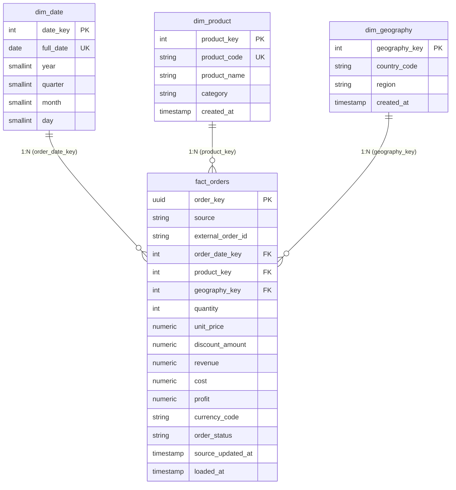

# Power BI Semantic Data Model & Star Schema Architecture

## 1. Architectural Overview

The Enterprise Intelligence Automation Platform (EIAP) implements a canonical Kimball-style **Star Schema** optimized for high-throughput reporting, slice-and-dice aggregations, and sub-second DAX query execution in Power BI.

The model separates numerical quantitative measures (`fact_orders`) from descriptive business context (`dim_date`, `dim_product`, `dim_geography`).

---

## 2. Table Specifications

### 2.1 Fact Table: `fact_orders`
- **Business Grain:** One record per physical line item ordered by a customer.
- **Natural Business Key:** `(source, external_order_id, product_key)` enforced via unique constraint `uq_fact_orders_grain`.
- **Primary Surrogate Key:** `order_key` (UUID v4).
- **Physical Indexes:**
  - B-Tree index on `order_date_key` (optimized for time-window range filtering).
  - B-Tree index on `product_key`.
  - B-Tree index on `geography_key`.
  - Composite B-Tree index on `(currency_code, order_status)`.

### 2.2 Dimension Table: `dim_date`
- **Role:** Conformed Date Dimension supporting standard calendar hierarchies.
- **Surrogate Key:** `date_key` (Integer in `YYYYMMDD` format, e.g., `20260327`).
- **Hierarchy:** `Year` -> `Quarter` -> `Month` -> `Date`.

### 2.3 Dimension Table: `dim_product`
- **Role:** Product Catalog Dimension.
- **Surrogate Key:** `product_key` (Auto-incrementing Integer).
- **Natural Key:** `product_code` (Unique String).
- **Hierarchy:** `Category` -> `Product Name`.

### 2.4 Dimension Table: `dim_geography`
- **Role:** Geographic Location Dimension.
- **Surrogate Key:** `geography_key` (Auto-incrementing Integer).
- **Hierarchy:** `Country Code` -> `Region`.

---

## 3. Power BI Relationship Topology

| From Table | From Column | To Table | To Column | Cardinality | Cross Filter Direction | Security Filter |
| :--- | :--- | :--- | :--- | :--- | :--- | :--- |
| `dim_date` | `date_key` | `fact_orders` | `order_date_key` | 1 to Many (1:*) | Single (`dim_date` filters `fact_orders`) | No |
| `dim_product` | `product_key` | `fact_orders` | `product_key` | 1 to Many (1:*) | Single (`dim_product` filters `fact_orders`) | No |
| `dim_geography` | `geography_key` | `fact_orders` | `geography_key` | 1 to Many (1:*) | Single (`dim_geography` filters `fact_orders`) | No |

---

## 4. Best Practices & Optimization Notes
1. **Single-Direction Filtering:** All dimension-to-fact relationships enforce single-direction cross-filtering to prevent ambiguous filter paths, cyclical dependencies, and sub-optimal DAX query plans.
2. **Currency Integrity:** Financial measures must always be filtered or grouped by `currency_code` before aggregation to prevent erroneous cross-currency summation without foreign exchange conversion.
3. **Integer Surrogate Keys:** Date, Product, and Geography foreign keys use lean 4-byte integers for VertiPaq dictionary encoding compression in Power BI Service / Desktop.

