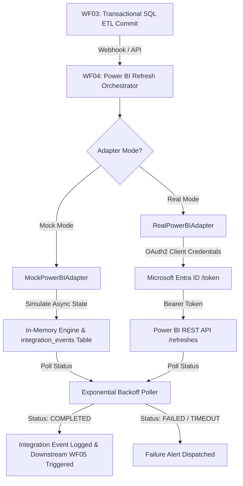

# Power BI Service REST API Integration Guide

## 1. Architecture & Operating Modes

The Enterprise Intelligence Automation Platform (EIAP) provides two execution modes for Power BI integration:

1. **Deterministic Mock Mode (Default - Zero Cloud Cost):**
   - Activated automatically when `FEATURE_FLAG_POWERBI_ENABLED=false` or `POWERBI_ADAPTER=mock`.
   - Simulates the complete asynchronous dataset refresh lifecycle: `QUEUED` -> `IN_PROGRESS` -> `COMPLETED` (or `FAILED` / `TIMED_OUT`).
   - Persists execution state and operational audits in PostgreSQL (`integration_events`).
   - Requires no Azure subscriptions, Microsoft Fabric capacities, or Power BI Pro/Premium licenses.
   - Ideal for continuous integration (CI) tests, local developer workstations, and portfolio review.

2. **Enterprise Production Mode (Microsoft Power BI REST API):**
   - Activated via `FEATURE_FLAG_POWERBI_ENABLED=true` and `POWERBI_ADAPTER=real`.
   - Communicates with Microsoft Power BI Service via OAuth2 client credentials grant through Microsoft Entra ID (formerly Azure AD).
   - Coordinates automated semantic model refresh upon transactional ETL commit.



---

## 2. Setting Up Enterprise Microsoft Entra ID & Power BI Service

If you choose to connect a live Microsoft Power BI tenant, follow these enterprise security configuration steps:

### Step 2.1: Register Azure AD Application (Service Principal)
1. Sign in to the [Azure Portal](https://portal.azure.com/).
2. Navigate to **Microsoft Entra ID** > **App registrations** > **New registration**.
3. Name: `EIAP-Automation-Service-Principal`.
4. Supported account types: **Accounts in this organizational directory only (Single tenant)**.
5. Click **Register**.
6. Note the **Application (client) ID** and **Directory (tenant) ID**.
7. Navigate to **Certificates & secrets** > **Client secrets** > **New client secret**.
8. Set expiration (e.g., 180 days) and record the secret **Value** securely.

### Step 2.2: Configure Power BI Tenant Settings
1. Open the [Power BI Admin Portal](https://app.powerbi.com/admin-portal).
2. Go to **Tenant settings** > **Developer settings**.
3. Locate **Allow service principals to use Power BI APIs**:
   - Set to **Enabled**.
   - Select **Specific security groups** and add a security group containing your registered Service Principal.
4. Locate **Allow service principals to create and use profiles** (if using Fabric profiles):
   - Set to **Enabled** for the security group.

### Step 2.3: Assign Workspace Permissions
1. Open your Power BI Workspace containing the semantic model (`ws-prod-analytics`).
2. Click **Manage access**.
3. Add the Service Principal (`EIAP-Automation-Service-Principal`) as **Contributor** or **Admin**.

---

## 3. Environment Variable Configuration

Update your `.env` configuration file on the platform server:

```ini
# Power BI Integration Feature Flags
FEATURE_FLAG_POWERBI_ENABLED=true
POWERBI_ADAPTER=real

# Service Principal Credentials (Never commit to Git!)
POWERBI_TENANT_ID=00000000-0000-0000-0000-000000000000
POWERBI_CLIENT_ID=11111111-1111-1111-1111-111111111111
POWERBI_CLIENT_SECRET=your_entra_id_client_secret_here
POWERBI_WORKSPACE_ID=22222222-2222-2222-2222-222222222222
POWERBI_DATASET_ID=33333333-3333-3333-3333-333333333333
```

---

## 4. API Endpoints Reference

### 4.1 Trigger Dataset Refresh
- **Method:** `POST`
- **URL:** `http://localhost:8000/v1/integrations/powerbi/refresh`
- **Headers:**
  - `X-API-Key: <EIAP_API_KEY>`
  - `X-Correlation-ID: <CORRELATION_ID>`
  - `Content-Type: application/json`
- **Payload:**
```json
{
  "dataset_id": "ds-default-enterprise-sales",
  "workspace_id": "ws-prod-analytics",
  "run_id": "4b6ec340-a1f9-4481-9b16-5e581dc41cfa",
  "simulate_failure": false,
  "simulate_timeout": false
}
```
- **Response (HTTP 202 Accepted):**
```json
{
  "correlation_id": "corr_c2957177242c",
  "status": "SUCCESS",
  "data": {
    "refresh_id": "pbi_ref_80d94f275a2d",
    "dataset_id": "ds-default-enterprise-sales",
    "workspace_id": "ws-prod-analytics",
    "run_id": "4b6ec340-a1f9-4481-9b16-5e581dc41cfa",
    "status": "IN_PROGRESS",
    "submitted_at": "2026-10-29T06:55:00.123456Z",
    "completed_at": null,
    "attempts": 0,
    "idempotent_replay": false,
    "adapter_mode": "mock"
  }
}
```

### 4.2 Poll Refresh Status
- **Method:** `GET`
- **URL:** `http://localhost:8000/v1/integrations/powerbi/refresh/{refresh_id}`
- **Response (HTTP 200 OK):**
```json
{
  "correlation_id": "corr_c2957177242c",
  "status": "SUCCESS",
  "data": {
    "refresh_id": "pbi_ref_80d94f275a2d",
    "dataset_id": "ds-default-enterprise-sales",
    "status": "COMPLETED",
    "submitted_at": "2026-10-29T06:55:00.123456Z",
    "completed_at": "2026-10-29T06:55:03.456789Z",
    "attempts": 2,
    "adapter_mode": "mock"
  }
}
```

